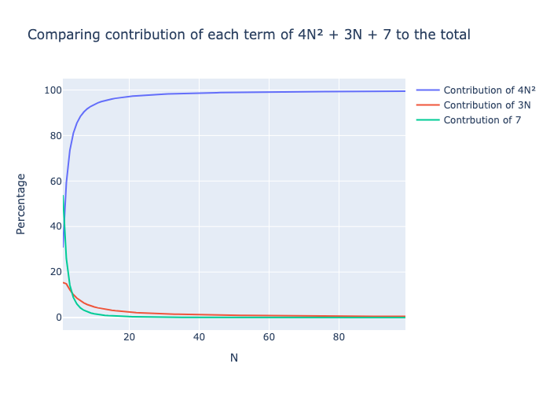
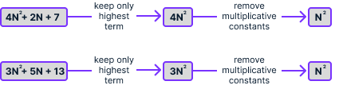
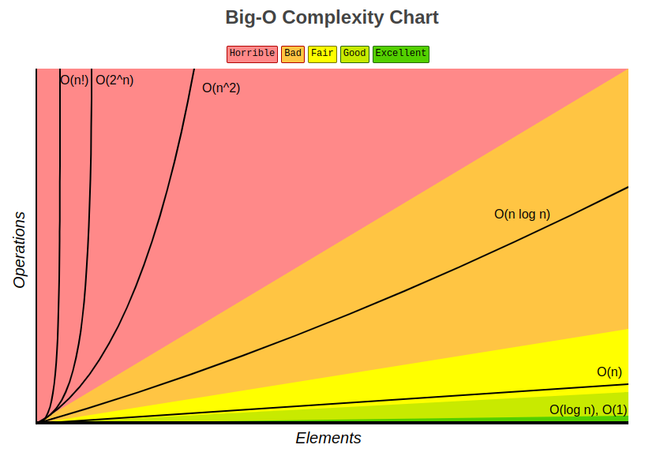
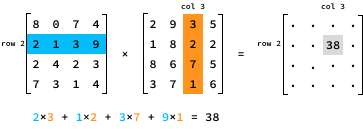
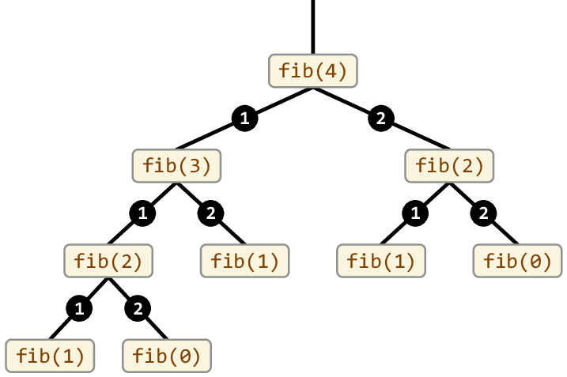
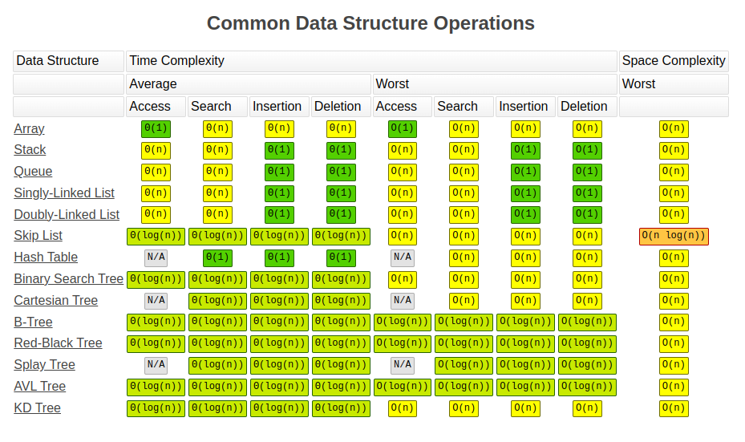
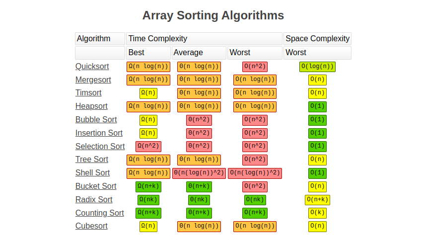
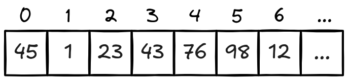

# Estrutura de Dados :mortar_board:
## Fundamentos: Introdução e Big-O

---

Fundamentos: Introdução e Big-O
## Por que analisar algoritmos?

---

## O Problema Fundamental

Imagine que dois desenvolvedores criaram soluções diferentes para resolver o **mesmo problema**:

- O algoritmo **A** levou $0.05$ segundos no computador de Maria.
- O algoritmo **B** levou $0.12$ segundos no notebook de João.

Podemos afirmar com certeza que o algoritmo **A** é melhor que o **B**?

---

## O Problema do "Tempo de Relógio" (*Wall-clock Time*)

Medir o tempo de execução em segundos/milissegundos depende de muitos fatores externos:

- Potência do processador (CPU) e quantidade de memória RAM
- Sistema operacional e outros programas rodando em segundo plano
- Linguagem de programação e nível de otimização do compilador/interpretador
- Tamanho e natureza da entrada testada

> ⚠️ Medir tempo em segundos mede o **ambiente**, não a **qualidade intrínseca do algoritmo**.

---

## O Objetivo da Análise de Algoritmos

Não queremos prever o milissegundo exato da execução. Queremos responder a duas perguntas essenciais:

---

> *"Considerando **dois algoritmos** que resolvem o mesmo problema, **qual deles será mais rápido** à medida que o volume de dados cresce?"*

---

> *"Se **dobrássemos o tamanho da entrada ($N \rightarrow 2N$)**, como o tempo de execução e a memória seriam afetados? O tempo dobra? Quadruplica? Permanece constante? Ou explode?"*

---

Fundamentos: Introdução e Big-O
## Contando Instruções e o Comportamento Assintótico

---

## Contando Instruções na Prática

Vamos analisar um algoritmo que calcula a soma de todos os números de uma lista:

```python
def sum_list(lst):
    total = 0           # 1 instrução (atribuição)
    for value in lst:   # N iterações
        total += value  # 1 instrução por iteração (N vezes)
    return total        # 1 instrução (retorno)
```

- Atribuição inicial: $1$
- Laço de repetição: $N$ execuções de `total += value`
- Retorno: $1$

**Total de instruções:** $f(N) = N + 2$

---

## E se tivermos fórmulas mais complexas?

Considere dois algoritmos fictícios com as seguintes contagens de instruções:

- Algoritmo 1: $f(N) = 4N^2 + 2N + 7$
- Algoritmo 2: $g(N) = 3N^2 + 5N + 13$

**Qual dos dois tem maior complexidade quando $N$ se torna gigantesco?**

---

## O Comportamento para $N$ pequeno vs $N$ grande



Para valores pequenos de $N$, as constantes e termos menores parecem fazer diferença...

---

## Para $N \rightarrow \infty$, o termo dominante governa!



Conforme $N$ cresce para milhares ou milhões, **ambos se comportam como $N^2$**! As constantes $4, 3, 7, 13$ tornam-se insignificantes.

---

Fundamentos: Introdução e Big-O
## Notações Assintóticas e Casos de Análise

---

## A Família Assintótica: $O$, $\Omega$ e $\Theta$

Na literatura de Ciência da Computação, existem três notações principais:

| Notação | Nome | Significado Intuitivo |
|---|---|---|
| **$O$ (Big-O)** | Limite Superior (*Upper Bound*) | *"O algoritmo não demora mais do que..."* (Pior teto) |
| **$\Omega$ (Big-Omega)** | Limite Inferior (*Lower Bound*) | *"O algoritmo demora pelo menos..."* (Piso) |
| **$\Theta$ (Big-Theta)** | Limite Justo (*Tight Bound*) | *"O algoritmo cresce exatamente na taxa de..."* |

> No dia a dia da indústria e entrevistas, usamos **Big-O** genericamente para nos referirmos ao limite superior do pior caso.

---

## Casos de Análise: Melhor, Pior e Médio

Um mesmo algoritmo pode ter tempos diferentes para uma entrada de mesmo tamanho $N$:

- **Melhor Caso (*Best Case*)**: Cenário onde tudo dá certo na primeira tentativa.
- **Caso Médio (*Average Case*)**: Desempenho esperado sobre entradas aleatórias.
- **Pior Caso (*Worst Case*)**: Cenário mais desfavorável possível.

---

## Exemplo: Busca Linear (*Linear Search*)

```python
def linear_search(arr, target):
    for i in range(len(arr)):
        if arr[i] == target:
            return i   # Encontrou!
    return -1          # Não encontrou
```

- **Melhor Caso:** O elemento está logo no índice `0` $\rightarrow \Omega(1)$
- **Pior Caso:** O elemento está no último índice ou **não existe** no vetor $\rightarrow O(N)$
- **Caso Médio:** O elemento está em algum ponto do meio $\rightarrow \Theta(N)$

> :bulb: Em engenharia de software e análise de sistemas, projetamos quase sempre pensando no **Pior Caso ($O(N)$)** para garantir segurança e previsibilidade!

---

Fundamentos: Introdução e Big-O
## As 4 Regras de Ouro do Big-O

---

## Regra 1: Descarte as Constantes

Multiplicações e divisões por constantes não alteram a ordem de grandeza do crescimento:

- $O(2N) \longrightarrow O(N)$
- $O(500) \longrightarrow O(1)$
- $O(3N^2 + 100) \longrightarrow O(N^2)$
- $O\left(\frac{N}{2}\right) \longrightarrow O(N)$

```python
# Faz duas passagens completas no vetor -> 2 * N operações -> O(N)
def print_twice(arr):
    for x in arr:
        print(x)
    for x in arr:
        print(x)
```

---

## Regra 2: Descarte os Termos Não-Dominantes

Quando temos termos de ordens diferentes somados, apenas o termo de maior crescimento importa quando $N \rightarrow \infty$:

- $O(N^2 + N) \longrightarrow O(N^2)$
- $O(N + \log N) \longrightarrow O(N)$
- $O(2^N + N^{100}) \longrightarrow O(2^N)$
- $O(N! + 2^N + N^3) \longrightarrow O(N!)$

---

```python
def process_data(arr):
    # Parte 1: O(N)
    for x in arr:
        print(x)
    # Parte 2: O(N^2) (DOMINANTE!)
    for i in arr:
        for j in arr:
            print(i, j)
# Complexidade total: O(N + N^2) = O(N^2)
```

---

## Regra 3: Entradas Diferentes $\rightarrow$ Variáveis Diferentes!

Se o algoritmo recebe **duas entradas independentes** (ex: listas $A$ e $B$ de tamanhos $N$ e $M$):

```python
def print_two_lists(list_a, list_b):
    for a in list_a:      # N vezes
        print(a)
    for b in list_b:      # M vezes
        print(b)
```

- :warning: **ERRADO:** $O(2N)$ ou $O(N)$
- :white_check_mark: **CORRETO:** $O(N + M)$ ou $O(A + B)$

Se forem loops aninhados com listas distintas:
- :white_check_mark: **CORRETO:** $O(N \cdot M)$ ou $O(A \cdot B)$

---

## Regra 4: Adição vs Multiplicação

- **Ações Sequenciais** ("Faça isso e *depois* faça aquilo"):
  - **SOMA** das complexidades: $O(A + B)$

```python
for item in list_a:  # O(A)
    pass
for item in list_b:  # O(B)
    pass
```
- **Ações Aninhadas** ("Para *cada* item de A, faça tudo de B"):
  - **MULTIPLICAÇÃO** das complexidades: $O(A \cdot B)$

```python
for a in list_a:      # O(A)
    for b in list_b:  # O(B)
        pass
```

---

Fundamentos: Introdução e Big-O
## O Zoológico das Complexidades

---

## O Ranking de Eficiência

Da melhor para a pior complexidade assintótica:

$$O(1) < O(\log N) < O(N) < O(N \log N) < O(N^2) < O(N^3) < O(2^N) < O(N!)$$

- :rocket: **Excelente:** $O(1)$, $O(\log N)$
- :white_check_mark: **Bom:** $O(N)$
- :large_orange_diamond: **Aceitável:** $O(N \log N)$
- :warning: **Ruim (Cuidado com N grande):** $O(N^2)$, $O(N^3)$
- :fire: **Terrível (Inviável para N > 30):** $O(2^N)$, $O(N!)$

---

## Gráfico Comparativo das Curvas Big-O



---

## $O(1)$ — Complexidade Constante

O tempo de execução **não depende** do tamanho da entrada.

```python
def is_even(n):
    return n % 2 == 0

def get_first_element(lst):
    return lst[0] if lst else None
```

- Não importa se a lista tem $10$ ou $10.000.000$ de itens, acessar pelo índice é imediato!
- Outros exemplos: adicionar elemento no topo de uma pilha, checar chave em dicionário (tabela hash).

---

## $O(\log N)$ — Complexidade Logarítmica

A cada iteração ou passo, o problema é **dividido pela metade**!

```python
def count_divisions_by_two(n):
    count = 0
    while n > 1:
        n = n // 2
        count += 1
    return count
```

- Se $N = 16 \longrightarrow$ $4$ passos ($16 \rightarrow 8 \rightarrow 4 \rightarrow 2 \rightarrow 1$)
- Se $N = 1.000.000 \longrightarrow$ apenas **$\approx 20$ passos**!
- Se $N = 1.000.000.000 \longrightarrow$ apenas **$\approx 30$ passos**!
- Exemplo clássico: **Busca Binária (*Binary Search*)** em lista ordenada.

---

## $O(\log N)$ — Busca Binária

```python
def binary_search(arr, target):
    left = 0
    right = len(arr) - 1
    
    while left <= right:
        mid = (left + right) // 2
        if arr[mid] == target:
            return mid
        elif arr[mid] < target:
            left = mid + 1
        else:
            right = mid - 1
            
    return -1
```

:pushpin: Divide o espaço de busca pela metade a cada comparação!

---

## $O(N)$ — Complexidade Linear

O tempo de execução cresce na **mesma proporção direta** que o tamanho da entrada.

```python
def sum_all(numbers):
    total = 0
    for num in numbers:
        total += num
    return total

def find_maximum(numbers):
    max_val = numbers[0]
    for num in numbers:
        if num > max_val:
            max_val = num
    return max_val
```

- Se dobrarmos os dados ($N \rightarrow 2N$), o tempo **dobra**.

---

## $O(N \log N)$ — Linearítmica / Quase-Linear

Ocorre frequentemente quando aplicamos a técnica de **Dividir para Conquistar**:
- O problema é dividido em $\log N$ níveis.
- Em cada nível, processamos todos os $N$ elementos.

```
Nível 0: [------------------ N ------------------]  -> N operações
Nível 1: [-------- N/2 --------][-------- N/2 --------] -> N operações
Nível 2: [-- N/4 --][-- N/4 --][-- N/4 --][-- N/4 --] -> N operações
... Total de níveis: log(N) ...
Total de operações: N * log(N)
```

- É o **limite teórico ótimo** para qualquer ordenação baseada em comparações!
- Exemplos: **Merge Sort**, **Quick Sort** (médio), **Heap Sort**, `arr.sort()` (Timsort).

---

## $O(N^2)$ — Complexidade Quadrática

Ocorre com muita frequência quando temos **dois laços aninhados** que percorrem a mesma entrada.

```python
def print_all_pairs(arr):
    n = len(arr)
    for i in range(n):
        for j in range(n):
            print(arr[i], arr[j])
```

- $N = 10 \longrightarrow 100$ operações
- $N = 1.000 \longrightarrow 1.000.000$ operações
- $N = 100.000 \longrightarrow 10.000.000.000$ operações (começa a travar o computador!)
- Exemplos: **Bubble Sort**, **Selection Sort**, **Insertion Sort** (pior caso).

---

## $O(N^2)$ — Bubble Sort

```python
def bubble_sort(arr):
    n = len(arr)
    for i in range(n - 1):
        for j in range(n - i - 1):
            if arr[j] > arr[j + 1]:
                arr[j], arr[j + 1] = arr[j + 1], arr[j]
    return arr
```

:pushpin: Compara pares adjacentes repetidamente até que tudo esteja ordenado. Complexidade de tempo: $O(N^2)$.

---

## $O(N^3)$ — Complexidade Cúbica

Três laços aninhados. Exemplo clássico: **Multiplicação Tradicional de Matrizes $N \times N$**.

```python
def matrix_multiply(a, b, n):
    res = [[0] * n for _ in range(n)]
    for i in range(n):
        for j in range(n):
            for k in range(n):
                res[i][j] += a[i][k] * b[k][j]
    return res
```

---

## Visualização $O(N^3)$ — O Cubo de Operações



Para cada célula $(i, j)$ da matriz resultante, percorremos $k$ de $0$ a $n-1$. O espaço de computação é tridimensional: $N \times N \times N = N^3$.

---

## $O(2^N)$ — Complexidade Exponencial

A cada novo elemento adicionado à entrada, o número de operações **dobra**!

```python
def fibonacci(n):
    if n <= 1:
        return n
    return fibonacci(n - 1) + fibonacci(n - 2)
```

- $N = 10 \longrightarrow \approx 1.024$ chamadas
- $N = 30 \longrightarrow \approx 1.000.000.000$ chamadas
- $N = 50 \longrightarrow \approx 1.125.899.906.842.624$ chamadas (levaria anos!)

---

## Árvore de Recursão do Fibonacci ($O(2^N)$)



A cada nível, o número de chamadas se ramifica em duas novas chamadas.

---

## $O(N!)$ — Complexidade Fatorial

Ocorre quando precisamos gerar todas as **permutações** possíveis de um conjunto (ex: Problema do Caixeiro-Viajante por Força Bruta).

```python
def permute(arr, current=[]):
    if not arr:
        print(current)
        return
    for i in range(len(arr)):
        remaining = arr[:i] + arr[i+1:]
        permute(remaining, current + [arr[i]])
```

- $N = 5 \longrightarrow 5! = 120$
- $N = 10 \longrightarrow 10! = 3.628.800$
- $N = 20 \longrightarrow 20! \approx 2,43 \times 10^{18}$ operações! (Mais que a idade do universo em segundos!)

---

## Tabela de Impacto: A Explosão dos Números

Supondo um processador que realiza $10^8$ operações por segundo:

| $f(N)$ | $N = 10$ | $N = 50$ | $N = 1.000$ | $N = 1.000.000$ |
|---|---|---|---|---|
| $O(1)$ | $< 1\mu s$ | $< 1\mu s$ | $< 1\mu s$ | $< 1\mu s$ |
| $O(\log N)$ | $< 1\mu s$ | $< 1\mu s$ | $< 1\mu s$ | $< 1\mu s$ |
| $O(N)$ | $< 1\mu s$ | $< 1\mu s$ | $< 1\mu s$ | $0.01$ s |
| $O(N \log N)$ | $< 1\mu s$ | $< 1\mu s$ | $< 1\mu s$ | $0.20$ s |
| $O(N^2)$ | $< 1\mu s$ | $< 1\mu s$ | $0.01$ s | **$\approx 3$ horas** |
| $O(2^N)$ | $10 \mu s$ | **357 anos** | Impossível | Impossível |
| $O(N!)$ | $0.03$ s | Impossível | Impossível | Impossível |

---

## Tabelas de Referência (Cheat Sheet)



---

## Tabelas de Referência: Ordenação



---

Fundamentos: Introdução e Big-O
## Complexidade de Tempo vs Espaço

---

## O que é Complexidade de Espaço (*Space Complexity*)?

Além do tempo, os algoritmos consomem **memória RAM**.

A complexidade de espaço mede a quantidade de **memória auxiliar** que o algoritmo aloca em função do tamanho da entrada $N$.

- **Espaço $O(1)$ (In-place):** Usa apenas algumas variáveis simples (ponteiros, contadores), independente de $N$.
- **Espaço $O(N)$:** Cria uma nova lista, dicionário ou conjunto proporcional a $N$.
- :bulb: **Pilha de Chamadas (*Call Stack*):** Funções recursivas consomem memória para cada chamada pendente na pilha!

---

## Estudo de Caso: Elementos Distintos em Vetor Ordenado

Dado um vetor **já ordenado**, quantos números diferentes existem nele?

Exemplo: `[1, 1, 2, 2, 2, 6, 6, 6, 6, 9, 10, 13, 20, 20, 21, 99]`

Vamos analisar **3 abordagens** com diferentes compromissos (*trade-offs*) de tempo e espaço!

---

## Abordagem 1: Vetor de Contagem (*Frequency Array*)

```python
def count_diffs_v1(nums):
    max_val = nums[-1]
    counters = [0] * (max_val + 1)  # Cria vetor até o maior elemento
    
    for n in nums:
        counters[n] += 1
        
    diffs = 0
    for c in counters:
        if c > 0:
            diffs += 1
    return diffs
```

- :pushpin: **Tempo:** $O(N + K)$, onde $K$ é o maior valor de `nums`.
- :pushpin: **Espaço:** $O(K)$ de memória auxiliar!
- ⚠️ **Problema:** Se `nums = [1, 10^9]`, alocaremos uma lista de $1$ bilhão de posições!

---

## Abordagem 2: Usando Conjunto Hash (`set`)

```python
def count_diffs_v2(nums):
    unique_elements = set()
    
    for n in nums:
        unique_elements.add(n)
        
    return len(unique_elements)
```

- :pushpin: **Tempo:** $O(N)$ — percorre a lista e insere no `set` em $O(1)$ médio.
- :pushpin: **Espaço:** $O(N)$ — o conjunto armazena até $N$ elementos únicos.
- Funciona para qualquer lista (ordenada ou não), mas **consome memória linear**.

---

## Abordagem 3: Aproveitando a Ordenação (*Dois Ponteiros*)

Como o vetor **já está ordenado**, números repetidos ficam sempre **lado a lado**!

```python
def count_diffs_v3(nums):
    if not nums:
        return 0
        
    count = 1
    for i in range(1, len(nums)):
        if nums[i] != nums[i - 1]:
            count += 1
            
    return count
```

- :pushpin: **Tempo:** $O(N)$ — uma única passada linear.
- :pushpin: **Espaço:** $O(1)$ — usa apenas uma variável inteira `count`!
- :trophy: **Solução Ótima em Tempo e Espaço!**

---

Fundamentos: Introdução e Big-O
## Análise Amortizada

---

## O que é Custo Amortizado?

Às vezes, uma operação é **muito rápida ($O(1)$) na imensa maioria das vezes**, mas **muito cara ($O(N)$) em raras ocasiões**.

A **Análise Amortizada** calcula o **custo médio por operação** ao longo de uma sequência longa de ações.

> *"O custo caro ocasional é diluído/amortizado pelas milhares de operações baratas!"*

---

## O Segredo do `list.append()` no Python

Como a lista do Python aumenta de tamanho dinamicamente?



1. A lista reserva um bloco contíguo na memória com capacidade $C$.
2. Inserir elementos é $O(1)$ enquanto houver espaço livre.
3. Quando a lista enche, o Python aloca um **novo bloco com o dobro da capacidade ($2C$)**, copia todos os $N$ elementos antigos e insere o novo ($O(N)$).
4. O custo médio por inserção continua sendo **$O(1)$ Amortizado**!

---

Fundamentos: Introdução e Big-O
## Cheat Sheet: Operações Nativas do Python

---

## Complexidade em Listas (`list`)

| Operação | Código / Método | Complexidade | Observação |
|---|---|---|---|
| Indexação / Acesso | `arr[i]` | $O(1)$ | Acesso direto via ponteiro |
| Tamanho | `len(arr)` | $O(1)$ | Python armazena o tamanho internamente |
| Inserção no final | `arr.append(x)` | $O(1)$ amort. | Muito eficiente |
| Remoção do final | `arr.pop()` | $O(1)$ | Remove último elemento |
| Inserção no início | `arr.insert(0, x)` | $O(N)$ | **Desloca todos** os elementos para a direita! |
| Remoção no início | `arr.pop(0)` | $O(N)$ | **Desloca todos** os elementos para a esquerda! |
| Busca linear | `x in arr` | $O(N)$ | Varre elemento a elemento |
| Fatiamento (*Slice*) | `arr[a:b]` | $O(k)$ | Onde $k = b - a$ (cria cópia) |
| Ordenação | `arr.sort()` | $O(N \log N)$ | Algoritmo Timsort |

---

## Complexidade em Dicionários (`dict`) e Conjuntos (`set`)

| Operação | Código / Método | Complexidade Média | Pior Caso |
|---|---|---|---|
| Acesso por chave | `d[key]` | $O(1)$ | $O(N)$ (colisão extrema) |
| Inserção / Atualização | `d[key] = val` | $O(1)$ | $O(N)$ |
| Remoção | `del d[key]` / `s.remove(x)` | $O(1)$ | $O(N)$ |
| Pertinência | `key in d` / `x in s` | $O(1)$ | $O(N)$ |

> :bulb: **Dica de Ouro:** Procurar `x in minha_lista` é $O(N)$. Procurar `x in meu_set` é $O(1)$!

---

Fundamentos: Introdução e Big-O
## Desafios Interativos: "Qual é a Complexidade?" :dart:

---

## Desafio 01 :dart:

Qual é a complexidade de **Tempo** e de **Espaço** deste algoritmo?

```python
def challenge_01(arr):
    n = len(arr)
    for i in range(0, n, 2):
        print(arr[i])
```

Pense:
- Quantas iterações o laço executa?
- Quanta memória auxiliar é alocada?

---

## Resposta 01 :white_check_mark:

- :pushpin: **Tempo:** $O(N)$
- :pushpin: **Espaço:** $O(1)$

**Explicação:**
O laço pula de $2$ em $2$, executando $\frac{N}{2}$ iterações.
Pela **Regra 1 (Descarte de Constantes)**:

$$O\left(\frac{N}{2}\right) = O\left(\frac{1}{2} \cdot N\right) \longrightarrow O(N)$$

A memória usada são apenas as variáveis `n` e `i`, portanto espaço constante $O(1)$.

---

## Desafio 02 :dart:

Qual é a complexidade de **Tempo** e de **Espaço** deste algoritmo?

```python
def challenge_02(n):
    i = 1
    while i < n:
        print(i)
        i = i * 2
```

Pense:
- Como a variável `i` cresce a cada passo?
- Quantas vezes `i` pode dobrar até atingir `n`?

---

## Resposta 02 :white_check_mark:

- :pushpin: **Tempo:** $O(\log N)$
- :pushpin: **Espaço:** $O(1)$

**Explicação:**
A cada iteração, `i` assume os valores: $1, 2, 4, 8, 16, \dots, 2^k$.
O laço para quando $2^k \ge n \implies k = \log_2(n)$.
Portanto, o número total de impressões é proporcional a $\log_2(n)$.

---

## Desafio 03 :dart:

Qual é a complexidade de **Tempo** e de **Espaço** deste algoritmo?

```python
def challenge_03(arr):
    n = len(arr)
    # Loop 1
    for x in arr:
        print(x)
        
    # Loop 2
    for i in range(n):
        for j in range(n):
            print(arr[i], arr[j])
```

---

## Resposta 03 :white_check_mark:

- :pushpin: **Tempo:** $O(N^2)$
- :pushpin: **Espaço:** $O(1)$

**Explicação:**
- O Loop 1 leva $O(N)$ operações.
- O Loop 2 leva $O(N \cdot N) = O(N^2)$ operações.
- Pela **Regra 4 (Adição)** e **Regra 2 (Termo Dominante)**:

$$O(N + N^2) \longrightarrow O(N^2)$$

O termo quadrático domina completamente o termo linear.

---

## Desafio 04 :dart:

Qual é a complexidade de **Tempo** e de **Espaço** deste algoritmo?

```python
def challenge_04(arr):
    n = len(arr)
    for i in range(n):
        for j in range(i + 1, n):
            print(arr[i], arr[j])
```

Atenção: o segundo laço começa em `i + 1` e não em `0`! Será que ainda é quadrático?

---

## Resposta 04 :white_check_mark:

- :pushpin: **Tempo:** $O(N^2)$
- :pushpin: **Espaço:** $O(1)$

**Explicação:**
Vamos somar o número de execuções do laço interno:
- Quando $i = 0$: $j$ roda $N - 1$ vezes
- Quando $i = 1$: $j$ roda $N - 2$ vezes
- ...
- Quando $i = N - 1$: $j$ roda $0$ vezes

$$\text{Total} = (N - 1) + (N - 2) + \dots + 1 + 0 = \frac{N(N - 1)}{2} = \frac{N^2 - N}{2} \longrightarrow O(N^2)$$

---

## Desafio 05 :dart:

Qual é a complexidade de **Tempo** desta função?

```python
def challenge_05(list_a, list_b):
    common = []
    for item in list_a:
        if item in list_b:       # ATENÇÃO AQUI!
            common.append(item)
    return common
```

Assuma que `len(list_a) == N` e `len(list_b) == M`.

---

## Resposta 05 :white_check_mark:

- :pushpin: **Tempo:** $O(N \cdot M)$
- :pushpin: **Espaço:** $O(\min(N, M))$ para armazenar a lista resultante.

**Explicação:**
O laço externo roda $N$ vezes.
A operação `item in list_b` faz uma **busca linear** na `list_b`, que custa $O(M)$ a cada iteração!
Portanto: $N \times O(M) = O(N \cdot M)$.

> :bulb: **Como otimizar para $O(N + M)$?**
> Converter `list_b` em `set(list_b)` antes do laço! A busca no conjunto passa a ser $O(1)$!

---

## Desafio 06 :dart:

Qual é a complexidade de **Tempo** ao concatenar strings repetidamente?

```python
def challenge_06(words):
    result = ""
    for w in words:
        result = result + w
    return result
```

Suponha uma lista de $N$ palavras, cada uma de tamanho $K$.

---

## Resposta 06 :white_check_mark:

- :pushpin: **Tempo:** $O(N^2 \cdot K)$ ou $O(N^2)$ se $K=1$.
- :pushpin: **Espaço:** $O(N \cdot K)$.

**Explicação:**
Em Python, **strings são imutáveis**.
A cada operação `result + w`, o Python cria uma **nova string na memória** e copia todos os caracteres anteriores!

- 1ª iteração: copia $K$ caracteres
- 2ª iteração: copia $2K$ caracteres
- ...
- $N$-ésima iteração: copia $N \cdot K$ caracteres
- Total: $K \cdot (1 + 2 + \dots + N) \approx O(N^2 \cdot K)$

> :bulb: **Forma correta ($O(N \cdot K)$ linear):** `"".join(words)`!

---

## Desafio 07 :dart:

Qual é a complexidade de **Tempo** e de **Espaço** desta função recursiva?

```python
def countdown(n):
    if n <= 0:
        return
    print(n)
    countdown(n - 1)
```

---

## Resposta 07 :white_check_mark:

- :pushpin: **Tempo:** $O(N)$
- :pushpin: **Espaço:** $O(N)$ na Pilha de Chamadas (*Call Stack*)!

**Explicação:**
A função é chamada $N$ vezes até atingir a condição de parada (`n <= 0`).
Como cada chamada fica aguardando na memória da pilha de execução antes de desempilhar, o espaço de memória utilizado é proporcional a $N$.

```
countdown(3) -> countdown(2) -> countdown(1) -> countdown(0)
[Pilha cresce até profundidade N]
```

---

## Desafio 08 :dart:

Qual é a complexidade do algoritmo **Two Sum** para um vetor **já ordenado**?

```python
def two_sum_sorted(nums, target):
    left = 0
    right = len(nums) - 1
    
    while left < right:
        current_sum = nums[left] + nums[right]
        if current_sum == target:
            return (left, right)
        elif current_sum < target:
            left += 1
        else:
            right -= 1
            
    return None
```

---

## Resposta 08 :white_check_mark:

- :pushpin: **Tempo:** $O(N)$
- :pushpin: **Espaço:** $O(1)$

**Explicação:**
Utilizamos a técnica clássica de **Dois Ponteiros (*Two Pointers*)**:
- A cada iteração do laço `while`, ou `left` avança $+1$, ou `right` recua $-1$.
- A distância total entre `left` e `right` é de $N$ posições.
- Portanto, o laço executa no máximo $N$ vezes, sem alocar memória auxiliar!

---

## Desafio 09 :dart:

Qual é a complexidade de **Tempo** desta função?

```python
def challenge_09(arr):
    n = len(arr)
    for i in range(n):
        j = 1
        while j < n:
            print(arr[i], j)
            j = j * 2
```

---

## Resposta 09 :white_check_mark:

- :pushpin: **Tempo:** $O(N \log N)$
- :pushpin: **Espaço:** $O(1)$

**Explicação:**
- O laço externo `for i in range(n)` executa exatamente $N$ vezes.
- Para **cada** valor de `i`, o laço interno `while j < n` dobra o valor de `j` ($1, 2, 4, 8, \dots$), executando $\log_2(N)$ vezes.
- Pela **Regra 4 (Multiplicação)**:

$$\text{Tempo Total} = N \times O(\log N) = O(N \log N)$$

---

## Desafio 10 :dart:

Analise as três abordagens para verificar se uma lista possui **elementos duplicados**:

- **Abordagem A (Força Bruta):** Comparar todos os pares com 2 laços aninhados.
- **Abordagem B (Ordenação):** Ordenar a lista e comparar elementos adjacentes.
- **Abordagem C (Tabela Hash / Set):** Inserir em um `set` e checar tamanho.

Qual é a complexidade de cada uma?

---

## Resposta 10 :white_check_mark:

| Abordagem | Complexidade de Tempo | Complexidade de Espaço | Observações |
|---|---|---|---|
| **A (Dois Loops)** | $O(N^2)$ | $O(1)$ | Lento, mas não gasta memória extra |
| **B (Ordenação)** | $O(N \log N)$ | $O(1)$ ou $O(N)$ | Bom equilíbrio |
| **C (Hash Set)** | $O(N)$ | $O(N)$ | **Mais rápido**, mas usa memória linear |

> :trophy: Em desenvolvimento profissional, entender Big-O permite escolher a melhor solução para os limites do seu sistema (CPU vs Memória)!

---

Fundamentos: Introdução e Big-O
## Resumo

---

## Resumo dos Pontos-Chave :bulb:

1. **Big-O** mede como o custo computacional cresce assintoticamente com o tamanho da entrada ($N$).
2. **Ignore constantes e termos menores:** $O(3N^2 + 5N + 10) \rightarrow O(N^2)$.
3. **Ações sequenciais se somam ($O(A + B)$); ações aninhadas se multiplicam ($O(A \cdot B)$).**
4. **Cuidado com operações escondidas** dentro de laços (`in list`, `.insert(0)`, concatenação de strings).
5. **Tempo vs Espaço:** muitas vezes podemos deixar um algoritmo mais rápido consumindo um pouco mais de memória (e vice-versa).
6. **Regra dos $10^8$:** Um computador moderno realiza aproximadamente $10^8$ operações básicas por segundo. Use isso para estimar se sua solução passará no tempo limite!

---

# Obrigado! :metal:

---

## Eduardo Cruz Araujo

- E-mail: [eduardo.araujo@cps.sp.gov.br](mailto:eduardo.araujo@cps.sp.gov.br)
- LinkedIn: [edcaraujo](https://www.linkedin.com/in/edcaraujo/)
- GitHub: [edcaraujo](https://github.com/edcaraujo)
